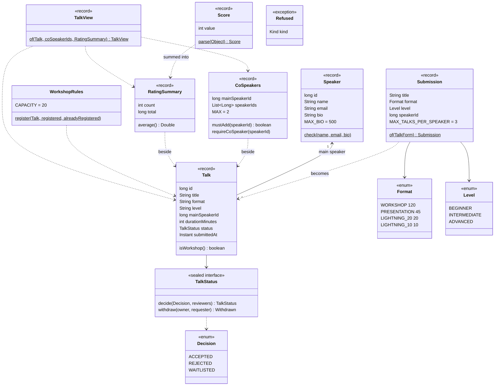
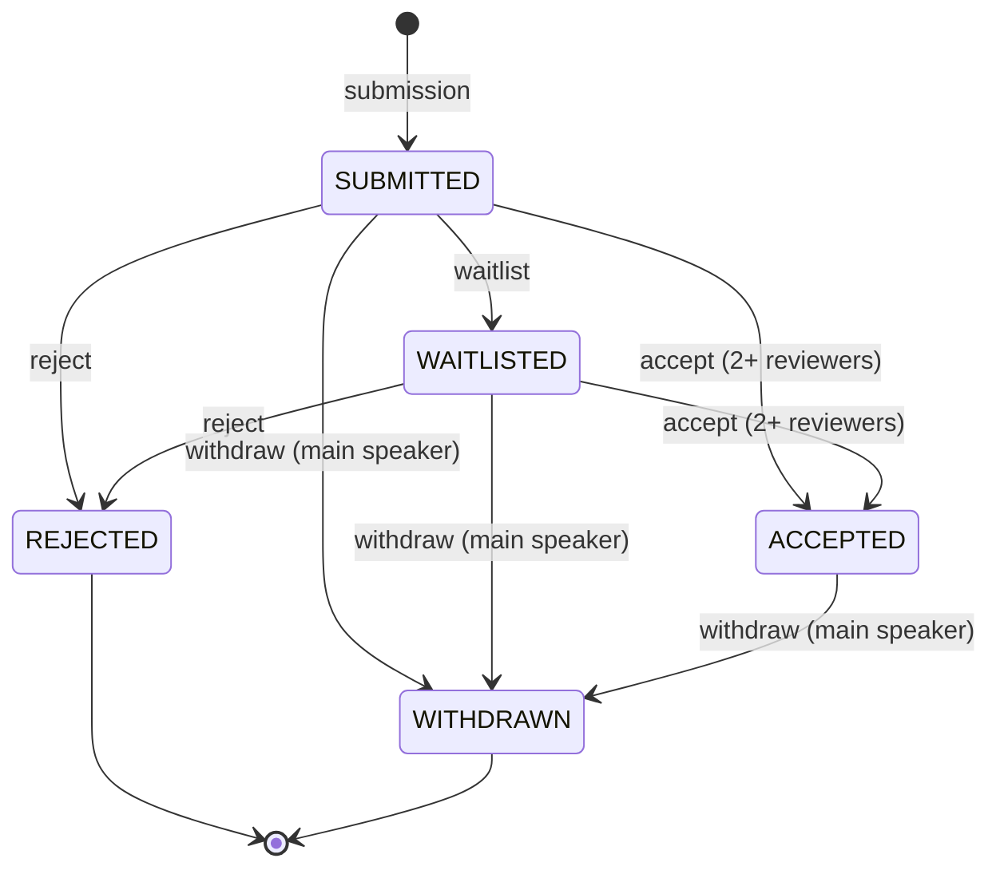
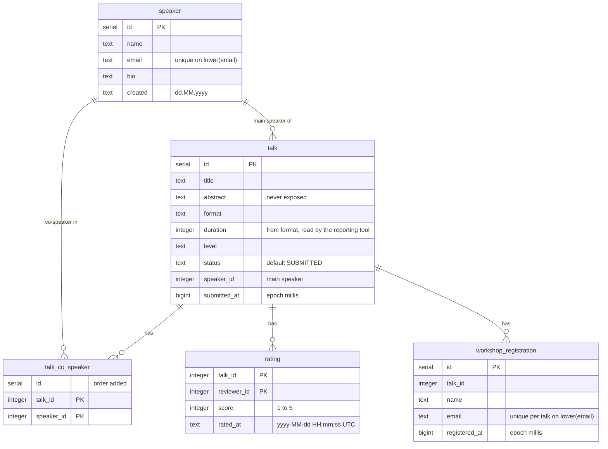
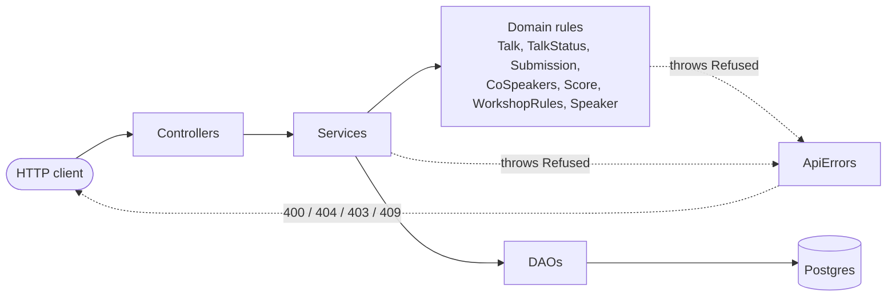
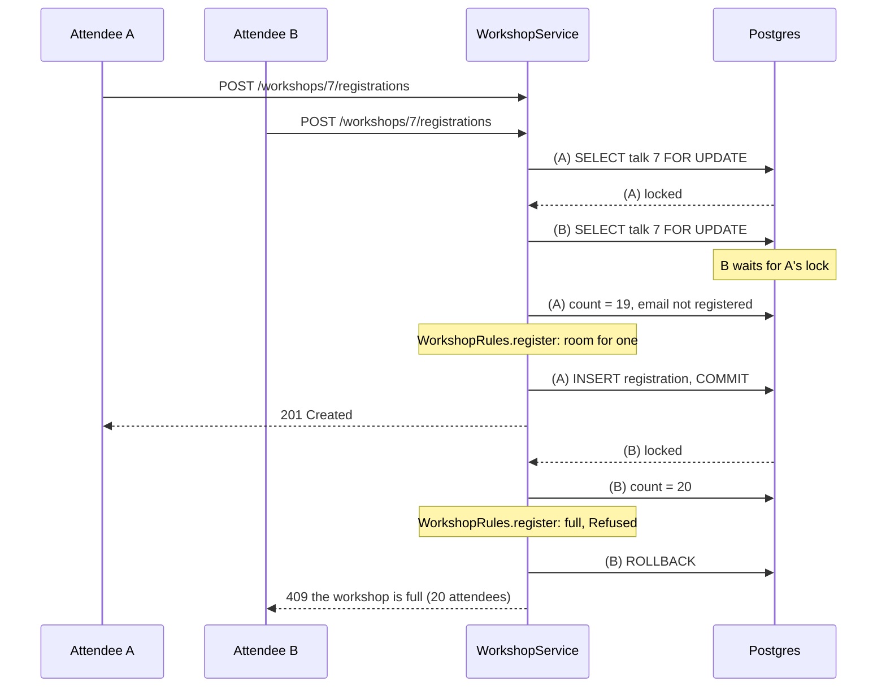

# Domain model

How the code maps the domain language of [GLOSSARY.md](../GLOSSARY.md). The rules live in plain Java types
(no Spring, no database); services load, lock and save around them. Decisions per feature are in
`workflow/specs/`.

## Domain types

- A `Talk` keeps format, level and duration as stored: older rows may hold values today's rules don't
  accept. New talks come from a `Submission`, which only takes a valid `Format` and `Level`.
- Co-speakers and ratings live in their own tables. `CoSpeakers` and `RatingSummary` are built beside the
  talk when needed, and `TalkView` joins all three into the API's talk.
- Any rule that says no throws `Refused` with a kind: `INVALID`, `NOT_FOUND`, `NOT_PERMITTED` or
  `NOT_ALLOWED`. The message is what the client sees.

## Talk status

Implemented by `TalkStatus`: one record per state, and each state only has the moves it allows.

Accepting needs ratings from at least two different reviewers. Any move not drawn is refused as
`NOT_ALLOWED` (409), and anyone but the main speaker withdrawing is `NOT_PERMITTED` (403), whatever the state.

## Tables

From `src/main/resources/schema.sql`. There are no foreign keys; the relations below are kept by the code.

The legacy `vote` table (2019 voting, replaced by ratings) is still created but not used by the code.

## Layers

Controllers only map HTTP to service calls. Services own the transaction, take the talk row lock where
needed, load what the rules need, call them and save. `ApiErrors` turns a `Refused` into the status code with
`sendError`, so the error body is Spring's default `{timestamp, status, error, message, path}`.

## A workshop rush

Every change to a talk, its co-speakers or its registrations locks the talk row first
([ADR 1](adr/0001-talk-row-lock.md)). Two attendees going for the last seat:

